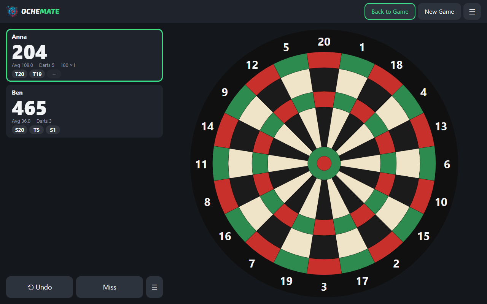
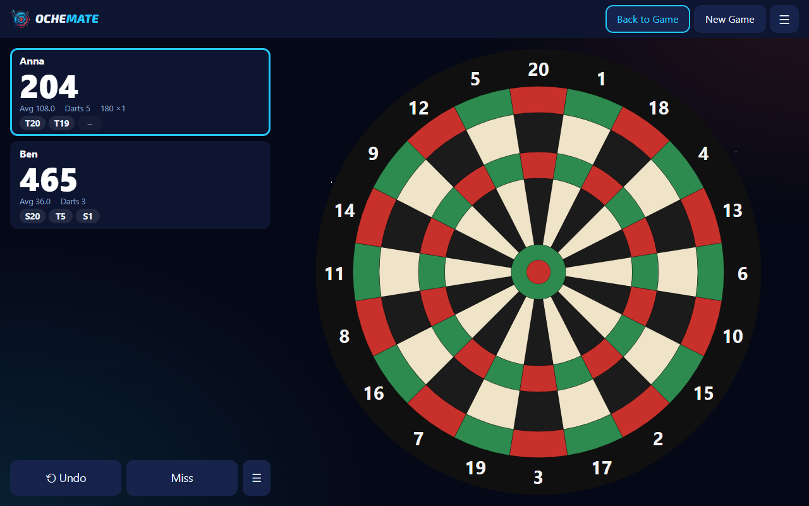
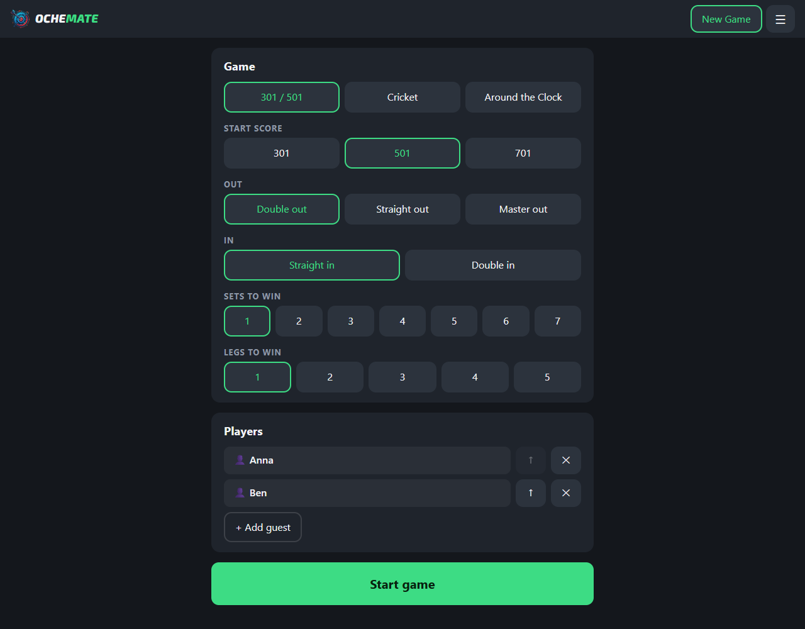
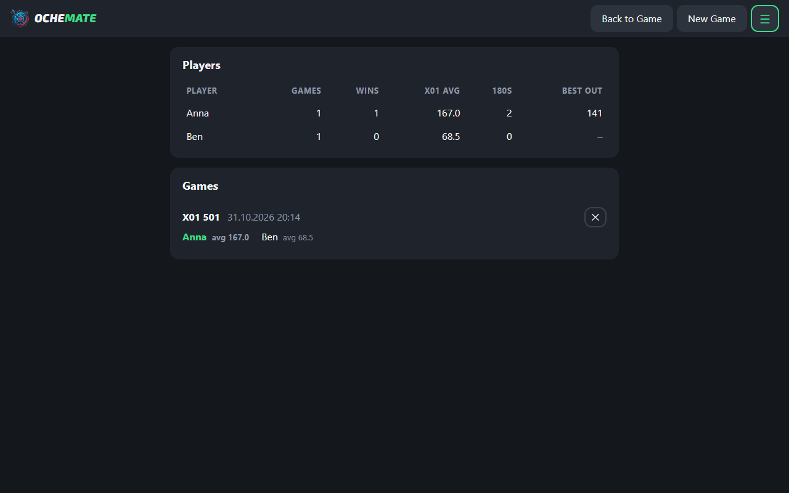
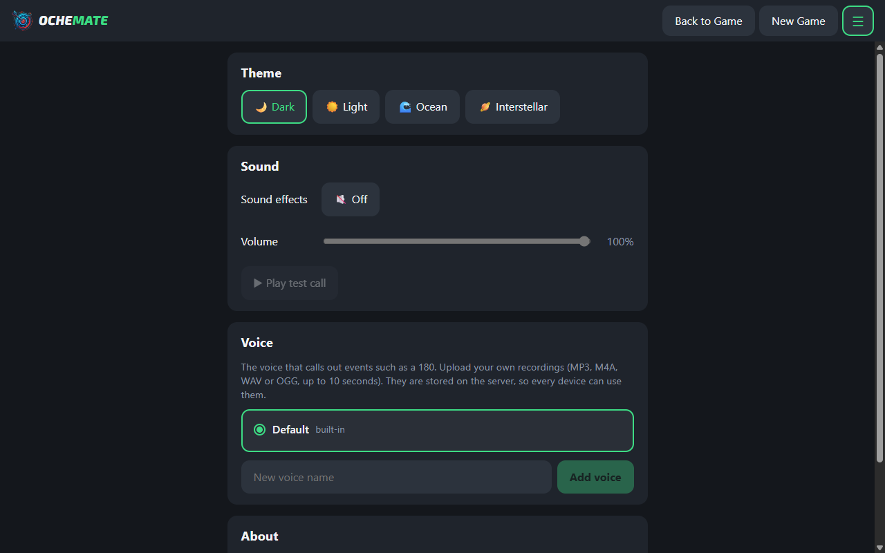

<h1 align="center">
  <picture>
    <source media="(prefers-color-scheme: dark)" srcset="docs/brand/banner-dark.svg">
    
  </picture>
</h1>

Ochemate is a self-hosted dart scorer for usage on tablet or notebook. Tap the on-screen board to score.

- Games: X01 (301/501/701, double-in, straight/double/master-out, legs, sets and deciding-set tie-break), Cricket, Around the Clock
- Checkout suggestions, 3-dart average, 180 counter, undo
- Saved players with stats: matches, wins, 180s, averages, checkout %, best leg
- Match history and per-player stats (stored in SQLite on the server)
- Settings: themes, sound on/off and volume, and custom voices (upload your own recording for the 180 call)
- Installable PWA, current game survives reloads

Stack: Angular 20 (`client/`) and Node + Express + `node:sqlite` (`server/`).

## Screenshots

| Game | Interstellar theme |
| --- | --- |
|  |  |

| New game | History and stats | Settings |
| --- | --- | --- |
|  |  |  |

## Run with Docker

```sh
docker compose up -d --build
```

Open `http://<server-ip>:8080` on the tablet. Data lives in the `dartboard-data` volume.

## Configuration

Environment variables for the server. With Docker, put them in a `.env` file next to `docker-compose.yml` (see `.env.example`).

| Variable | Default | Meaning |
| --- | --- | --- |
| `VOICE_UPLOADS` | `on` | `off` makes the voice API read-only: no uploads, renames or deletes, and the Settings screen hides those controls. Existing voices still work. **Set it to `off` for a public deployment.** Any value other than on/off counts as off, so a typo never opens uploads. |
| `PORT` | `8080` | Port the server listens on. |
| `DB_PATH` | `./data/dartboard.db` | SQLite database file (matches, players, voices). |
| `STATIC_DIR` | `./public` | Built client files to serve. |

## Develop

```sh
cd server && npm install && npm start          # API on :8080 (needs Node >= 22.13)
cd client && npm install && npx ng serve --proxy-config proxy.conf.json
```

## Notes

- No authentication: anyone who can reach the port can read and delete history and add or delete voices (recordings up to 1 MB each, at most 20 voices). Keep it on the LAN, or for a public deployment set `VOICE_UPLOADS=off` (see Configuration) and put it behind a reverse proxy with auth.
- Service worker / "Add to Home Screen" install needs HTTPS (or localhost). Plain `http://<ip>:8080` works as a normal web app; for the installable PWA put it behind a TLS-terminating proxy.
- Game state is a log of darts; scores are recomputed by replay (`client/src/app/game-logic.ts`). Undo = drop the last dart.

## Credits

- Wordmark font: [Exo 2](https://github.com/googlefonts/Exo-2.0) by The Exo 2 Project Authors, SIL Open Font License 1.1 (`client/public/fonts/Exo2-OFL.txt`). Self-hosted, no external requests.

## License

Code: [GNU AGPL-3.0-or-later](LICENSE). If you run a modified version as a network service, you must offer its source to the users of that service.

The project name, logo and voice clips are not covered by this licence. The clips in `client/public/sounds/default/` are under CC BY-NC-ND 4.0 (see the `LICENSE.txt` next to them). Third-party components keep their own licences (see Credits).

Ochemate is an independent open-source project and is not affiliated with, endorsed by or linked to any other products, brands or services.
